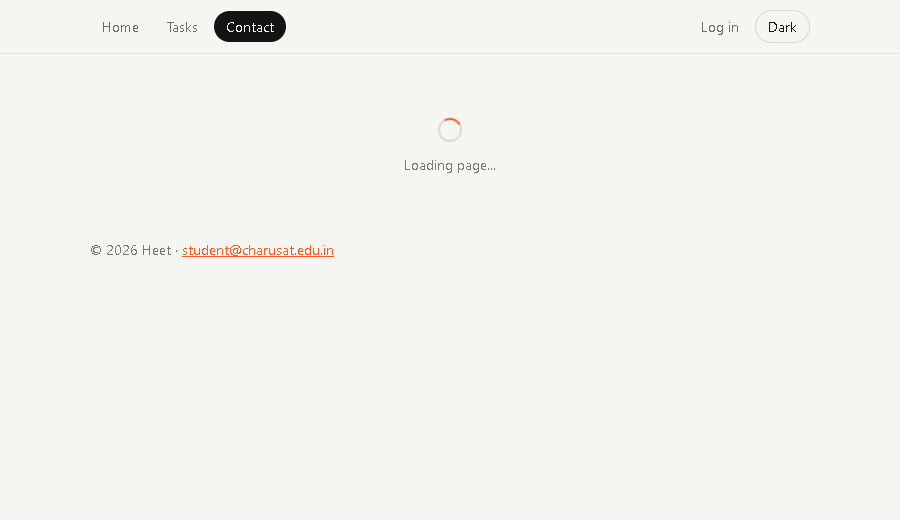

# Performance: before vs after lazy loading

**Before** is the same app with every page and the chart imported statically (one bundle).
**After** uses `React.lazy()` + `Suspense` for the Tasks, Contact, Login and NotFound routes, and for the recharts `TaskChart`.

## 1. Vite build output (`npm run build`)

| Build  | File                     | Size      | Gzip      |
| ------ | ------------------------ | --------- | --------- |
| Before | `index.js` (everything)  | 548.92 kB | 164.80 kB |
| After  | `index.js` (main bundle) | 164.07 kB | 54.40 kB  |
| After  | `jsx-runtime.js` (shared)| 7.78 kB   | 2.99 kB   |
| After  | `Tasks.js`               | 5.41 kB   | 2.02 kB   |
| After  | `Login.js`               | 1.64 kB   | 0.80 kB   |
| After  | `Contact.js`             | 0.95 kB   | 0.51 kB   |
| After  | `NotFound.js`            | 0.37 kB   | 0.25 kB   |
| After  | `TaskChart.js` (recharts)| 371.38 kB | 106.81 kB |

Before the change, Vite also warned that the bundle was over 500 kB. That warning is gone after the change.

## 2. Network tab: first visit to `/`

These were measured in Edge with the cache disabled, using `vite preview`, 3 reloads each.

| Build  | Network         | JS files | JS transferred | Load event (ms)  | Median   |
| ------ | --------------- | -------- | -------------- | ---------------- | -------- |
| Before | No throttling   | 1        | 159.8 KB       | 69 / 87 / 113    | 87 ms    |
| After  | No throttling   | 2        | 56.1 KB        | 69 / 33 / 48     | 48 ms    |
| Before | Slow 3G         | 1        | 159.8 KB       | 3511 / 3488 / 3507 | 3507 ms |
| After  | Slow 3G         | 2        | 56.1 KB        | 1831 / 1854 / 1810 | 1831 ms |

On the first visit, about **65% less JavaScript** is downloaded. On Slow 3G the page becomes usable in about **half the time**.

## 3. Chunk loading observed

* Navigating to `/contact` requests only `Contact-*.js`. The fallback below was captured on a throttled connection.
* `TaskChart-*.js` (recharts) is **not** requested when `/tasks` loads. It is requested only after you click **Show chart**.

## 4. Minimum-delay fallback

`DelayedFallback` keeps the spinner hidden for the first 300 ms. On fast lab Wi-Fi the chunk arrives sooner than that, so nothing flickers. On Slow 3G the spinner appears as shown above.

## 5. Unnecessary re-render found with the React DevTools Profiler

* **Symptom:** ticking one task's checkbox re-rendered **every** `TaskItem` in the list. Each row received new inline arrow functions (`onToggle={() => ...}`) on every render of `Tasks`.
* **Fix:** `TaskItem` is wrapped in `memo()`. `Tasks` now passes stable callbacks (`useCallback`) that take the task as an argument (`onToggle(task)`).
* **Result:** after the fix, only the toggled row re-renders, which you can confirm with "Highlight updates when components render" in React DevTools.

## Why this works (and when it doesn't)

* Lazy loading changes **when** code is downloaded, not **how much** is downloaded over a whole session. If you visit every page and open the chart, you still download everything.
* It improves perceived performance because the landing page only needs the main bundle.
* For a very small app (like Practical 1) splitting is not worth it. Each extra chunk costs a network round-trip, which can cost more than it saves.
